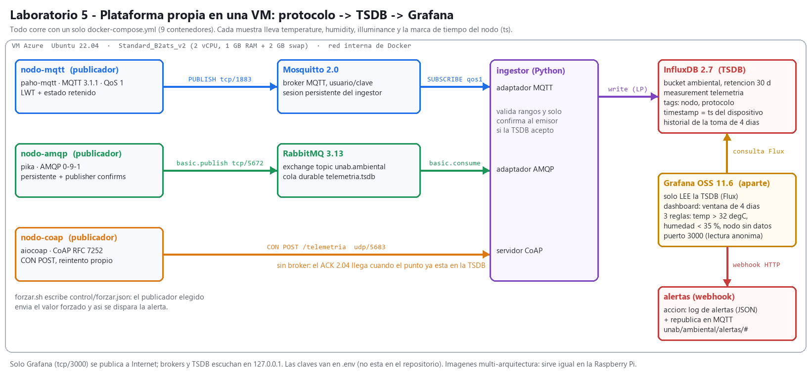

# Laboratorio 5 — Visualización + reglas/alertas: MQTT, AMQP y CoAP con Grafana en una VM

**IoT + Cloud + Sistemas Distribuidos · Universidad Autónoma de Bucaramanga · Escenario UNAB-Ambiental**

**Integrantes:** Daniel Villamizar · Tomás Urieles · David Guerrero

Inicio de la **plataforma propia** (ya sin IoT Central): una VM con Docker Compose donde tres nodos publican las 3 variables
del escenario (`temperature`, `humidity`, `illuminance`), **cada uno por un protocolo distinto** (MQTT, AMQP 0-9-1 y CoAP),
un ingestor las escribe en una **TSDB (InfluxDB 2)** con la marca de tiempo real del dispositivo, y **Grafana OSS**, instalado
aparte de la ingesta, muestra la **toma de 4 días** y dispara **alertas por umbral**.



| Pieza | Qué se usó | Qué queda andando |
|---|---|---|
| Protocolo | **Los tres**: MQTT 3.1.1 (Mosquitto 2.0), **AMQP 0-9-1** (RabbitMQ 3.13) y CoAP RFC 7252 (aiocoap). Principal declarado: **MQTT**. | 3 publicadores, uno por protocolo, un mensaje cada 15 s cada uno |
| TSDB | **InfluxDB 2.7** (bucket `ambiental`, retención 30 d) | measurement `telemetria`, tags `nodo` y `protocolo`, timestamp = `ts` del nodo |
| Grafana | **Grafana OSS 11.6**, datasource Flux de solo lectura | dashboard con ventana de 4 días + 3 reglas de alerta + webhook |

---

## 1. Estructura del repositorio

```
docker-compose.yml            9 servicios: mosquitto, rabbitmq, influxdb, ingestor, nodo-mqtt, nodo-amqp, nodo-coap, grafana, alertas
.env.example                  variables y claves de ejemplo (el .env real NO está en el repo)
plataforma/                   una sola imagen Python para publicadores, ingestor y webhook
  sensor.py                   modelo del sensor (ciclo día/noche de Bucaramanga) + valor forzado
  pub_mqtt.py                 publicador MQTT  (paho, QoS 1, LWT, cola local de reenvío)
  pub_amqp.py                 publicador AMQP 0-9-1 (pika, mensajes persistentes, publisher confirms)
  pub_coap.py                 publicador CoAP  (aiocoap, CON POST /telemetria)
  ingestor.py                 MQTT + AMQP + servidor CoAP  ->  InfluxDB (confirma solo si la TSDB aceptó)
  webhook.py                  acción de la alerta: log JSON + republicación por MQTT
mosquitto/ rabbitmq/          configuración de los brokers
grafana/provisioning/         datasource, dashboard y alertas como archivos (nada se configura a mano)
grafana/gen_dashboard.py      genera grafana/dashboards/unab-ambiental.json
scripts/
  instalar_vm.sh              Docker + swap + NTP en una VM limpia (o Raspberry Pi OS 64 bits)
  forzar.sh                   fuerza un valor en un publicador para disparar la alerta
  consulta.sh                 consultas Flux directas a la TSDB (ultimos | resumen | huecos)
  resumen_toma.py             inicio, fin, completitud y huecos de la toma
  vigilar_alertas.sh          imprime el estado de las reglas cada 10 s
informe/                      generadores del informe, del diagrama y de las imágenes de evidencia
mediciones/                   logs y salidas REALES tomados de la VM
evidencias/                   capturas (consulta, dashboard, alerta disparada)
Informe_Laboratorio5.pdf      informe de 2 páginas
```

## 2. Cómo levantar la VM (sin secretos)

Probado en **Azure, Ubuntu 22.04, Standard_B2ats_v2 (2 vCPU, 1 GB RAM)**. Sirve cualquier Linux x86-64 o arm64.

```bash
# 1) VM nueva (ejemplo con Azure CLI; la clave SSH la genera az y queda en ~/.ssh)
az vm create -g <grupo> -n vm-lab5 --image Ubuntu2204 --size Standard_B2ats_v2 --admin-username azureuser --generate-ssh-keys
az network nsg rule create -g <grupo> --nsg-name vm-lab5NSG -n allow-grafana-3000 --priority 1010 \
   --access Allow --protocol Tcp --direction Inbound --destination-port-ranges 3000

# 2) dentro de la VM
git clone https://github.com/Daniverd15/Laboratorio-5.git lab5 && cd lab5
sudo ./scripts/instalar_vm.sh          # Docker Engine + compose, 2 GB de swap, hora por NTP, rotación de logs

# 3) claves (cada valor con:  openssl rand -hex 16)
cp .env.example .env && nano .env && chmod 600 .env
mkdir -p control alertas-log && echo '{}' > control/forzar.json

# 4) levantar todo
sudo docker compose up -d --build
sudo docker compose ps                 # 9 servicios "Up"; mosquitto, rabbitmq e influxdb "healthy"
```

Grafana queda en `http://<IP-de-la-VM>:3000` (lectura sin cuenta; el usuario `admin` y su clave están en `.env`).
El dashboard **UNAB-Ambiental · Estación meteorológica** es la página de inicio.
Brokers y TSDB solo escuchan en `127.0.0.1`; para verlos desde el PC se usa un túnel:
`ssh -L 15672:localhost:15672 -L 8086:localhost:8086 azureuser@<IP>` (RabbitMQ en `:15672`, InfluxDB en `:8086`).

**La toma de 4 días arranca sola** con `docker compose up`: los tres publicadores empiezan a enviar de inmediato y todos los
servicios tienen `restart: unless-stopped`, así que sobreviven a un reinicio de la VM.

## 3. Protocolos: qué hace cada nodo

Las tres rutas llevan **el mismo JSON** (≈ 110 B): `{"nodo":"nodo-mqtt","seq":24,"ts":1791870199693,"temperature":19.7,"humidity":89.2,"illuminance":3.1}`

| | `nodo-mqtt` | `nodo-amqp` | `nodo-coap` |
|---|---|---|---|
| Protocolo / versión | MQTT 3.1.1 | **AMQP 0-9-1** | CoAP (RFC 7252) |
| Transporte | TCP 1883 | TCP 5672 | UDP 5683 |
| Intermediario | Mosquitto 2.0 | RabbitMQ 3.13 | ninguno: el ingestor es el servidor CoAP |
| Destino | tópico `unab/ambiental/<nodo>/telemetria` | exchange `unab.ambiental` (topic), rk `telemetria.<nodo>` → cola durable `telemetria.tsdb` | recurso `POST /telemetria` |
| Garantía | QoS 1 (PUBACK) | mensaje persistente + *publisher confirm* + `mandatory` | mensaje CON → ACK `2.04 Changed` |
| Si el ingestor se cae | el broker guarda la sesión persistente del ingestor | la cola durable acumula | el nodo no recibe ACK y reintenta desde su cola local |
| Librería | paho-mqtt 2.1 | pika 1.3 | aiocoap 0.4 |

Regla común del ingestor: **solo confirma (PUBACK / `basic.ack` / `2.04`) después de que InfluxDB aceptó el punto**, y guarda el
`ts` del dispositivo (no la hora de llegada). Como `measurement + tags + timestamp` identifican el punto, una reentrega no duplica datos.

**¿Por qué MQTT como protocolo principal?** Es el que mejor encaja con el dispositivo final (ESP32 / Raspberry Pi): cabecera de 2 bytes,
una sola conexión saliente por TCP, QoS 1, sesión persistente y LWT para saber si el nodo se cayó. AMQP se deja para lo que hace bien
—enrutar y encolar entre servicios de la plataforma (cola durable, confirms, *dead-lettering*)— y CoAP para nodos muy restringidos:
en el cable fueron **131 B de UDP por muestra y un ACK de 6 B** ([evidencia](evidencias/04-brokers-amqp-mqtt-coap.png)), sin
conexión que mantener, pero sin broker que guarde mensajes y con problemas para atravesar NAT. Se montaron los tres porque el enunciado
lo permite y así se comparan sobre la misma TSDB: retardo dispositivo → TSDB **p50 = 1–2 ms** en los tres dentro de la VM.

## 4. TSDB: cómo consultar los puntos guardados

```bash
sudo ./scripts/consulta.sh ultimos     # últimos 5 puntos crudos de cada nodo
sudo ./scripts/consulta.sh resumen     # puntos por nodo, inicio y fin de la toma, mín/media/máx por variable
sudo ./scripts/consulta.sh huecos      # intervalos de más de 30 s sin datos
sudo python3 scripts/resumen_toma.py   # inicio, fin, esperados vs recibidos, completitud y lista de huecos
```

Esquema: bucket `ambiental` · measurement `telemetria` · tags `nodo`, `protocolo` · campos `temperature`, `humidity`,
`illuminance`, `seq`, `lat_ms` (retardo dispositivo → TSDB) y `forzado`.

## 5. Grafana: dashboard y alertas

Grafana **no participa en la ingesta**: solo tiene un datasource de lectura hacia InfluxDB (Flux). Todo está aprovisionado desde
`grafana/provisioning/`, así que al levantar el stack ya aparecen el datasource, el dashboard y las reglas.

**Dashboard** (`/d/unab-ambiental`, rango por defecto *últimos 4 días*, hora de Bogotá):
título y una línea de qué mira el operador · *gauges* de temperatura (10–45 °C) y humedad (0–100 %) · *stat* de iluminancia (0–100 000 lux) ·
edad del último dato y puntos guardados por nodo · series temporales de las 3 variables con el umbral dibujado ·
muestras por minuto (los huecos caen a 0) · retardo dispositivo → TSDB · lista de alertas.

**Reglas** (`grafana/provisioning/alerting/alertas.yml`, se evalúan cada 30 s, una instancia por nodo):

| Regla | Condición | Ventana | Sostenida | Severidad |
|---|---|---|---|---|
| **Temperatura alta** | promedio > **32 °C** | últimos 2 min | 1 min | crítica |
| Humedad baja | promedio < 35 %HR | últimos 2 min | 1 min | aviso |
| Nodo sin datos | último punto hace > 90 s | mira 30 min | 30 s | aviso |

**Acción:** punto de contacto *webhook* → servicio `alertas`, que (1) añade una línea JSON a `alertas-log/alertas.log`,
(2) la escribe en su log y (3) la republica retenida en MQTT, `unab/ambiental/alertas/<regla>/<nodo>`, para un actuador.
También avisa cuando la alerta se resuelve.

### Disparar la alerta (forzando el valor desde el publicador)

```bash
./scripts/vigilar_alertas.sh 60 &                       # estado de las reglas cada 10 s
sudo ./scripts/forzar.sh nodo-mqtt temperature 41 300   # el publicador MQTT envía 41 °C durante 5 min
sudo docker compose logs -f alertas                     # FIRING ... y luego RESOLVED
```

Resultado medido el 2026-10-13 (hora de Bogotá): forzado 00:43:12 → **Pending 00:44:46 → Firing 00:45:46** → webhook 00:45:56 →
fin del forzado 00:48:12 → **Normal 00:49:16** → webhook *resolved* 00:49:56.

## 6. La toma de 4 días

| | |
|---|---|
| Inicio | **2026-10-13 00:35:20** (hora de Bogotá, UTC−5) |
| Fin previsto | 2026-10-17 00:35 (4 días = 23 040 muestras por nodo a una cada 15 s) |
| Huecos | ver `mediciones/20_resumen_toma.txt` (se regenera con `scripts/resumen_toma.py`) |

Huecos conocidos al inicio de la toma:

- **Provocado:** `nodo-amqp`, 00:50:34 → 00:53:49 del 13-oct (195 s). Se detuvo el publicador a propósito para comprobar que la regla
  *Nodo sin datos* lo detecta y que el panel *Muestras por minuto* lo muestra ([evidencia](evidencias/15-hueco-nodo-sin-datos-firing.png)).
- **No hubo hueco** al detener el ingestor 73 s: los brokers y el nodo CoAP retuvieron las muestras y se escribieron con su marca de
  tiempo original ([evidencia](evidencias/17-hueco-y-resiliencia.png)).
- El pico de 41 °C de `nodo-mqtt` entre 00:43 y 00:48 del 13-oct es el **valor forzado** para la alerta, no un dato del sensor
  (queda marcado con el campo `forzado=true`).

## 7. Qué falló al instalar en la VM (y cómo se resolvió)

| Problema | Causa | Solución |
|---|---|---|
| La VM solo tiene **891 MB de RAM** para 9 contenedores | tamaño B2ats_v2 (el más barato de la suscripción de estudiante) | 2 GB de swap, `mem_limit` por servicio, `vm_memory_high_watermark` de RabbitMQ en 256 MiB. Uso real: ≈ 430 MB RAM + 330 MB swap |
| Grafana: `Dashboard cannot be changed to a folder` y el dashboard no aparecía | la carpeta aprovisionada tenía el **mismo UID** que el dashboard | `folderUid` distinto y borrar el volumen `grafana-data` (el estado malo quedaba guardado) |
| `nodo-mqtt` se reiniciaba al arrancar con `RuntimeError: Message publish failed` | paho lanza excepción en `wait_for_publish` si se publica antes del CONNACK | publicar solo si `is_connected()`; la muestra espera en la cola local |
| Primer `POST` de `nodo-coap` sin ACK (`NetworkError`) | el nodo arrancó antes de que el servidor CoAP escuchara | cola local + reintento en el siguiente ciclo (no se perdió la muestra) |
| `System clock synchronized: no` | la VM venía de estar desasignada | `timedatectl set-ntp true` en `instalar_vm.sh` (la TSDB depende de la hora real) |
| Consulta Flux de resumen: `cannot join on an empty table` | `join` de tablas agrupadas distinto | se reemplazó por varios `yield` independientes |
| `resumen_toma.py`: `Invalid isoformat string` | Python 3.10 de la VM no acepta fracciones de segundo de longitud variable | parseo propio del RFC 3339 |
| Scripts `.sh` editados en Windows | fin de línea CRLF | `.gitattributes` fuerza LF |

## 8. Seguridad y límites (lo que NO se hizo)

- Hacia Internet solo está abierto **3000/tcp** (Grafana, rol *Viewer* anónimo de solo lectura) y 22/tcp (SSH por llave).
  MQTT, AMQP, CoAP e InfluxDB escuchan en `127.0.0.1` de la VM. Todas las claves están en `.env` (fuera del repo).
- Dentro de la red de Docker los protocolos van **sin TLS** (MQTT 1883, AMQP 5672, CoAP sin DTLS): aceptable porque no salen de la VM;
  antes de conectar un dispositivo real hay que activar TLS/DTLS y abrir el puerto correspondiente (`BIND_MQTT`, `BIND_COAP`).
- Los sensores son **simulados** (modelo día/noche en `sensor.py`); en la Raspberry Pi se reemplaza `Sensor.leer()` por la lectura real.
- La acción de la alerta es un **webhook propio** (log + MQTT), no correo: Grafana no tiene SMTP configurado.
- Una sola VM y un solo ingestor: no hay alta disponibilidad.

## 9. Migración a la Raspberry Pi

Todas las imágenes son multi-arquitectura (`linux/arm64`), y la imagen propia se construye en el destino. En Raspberry Pi OS de 64 bits:
`sudo ./scripts/instalar_vm.sh && cp .env.example .env && sudo docker compose up -d --build`. Para llevarse el historial:
`docker compose exec influxdb influx backup /tmp/b` en la VM y `influx restore` en la Pi. Si la Pi también es el nodo sensor,
basta con dejar un solo publicador (por ejemplo `nodo-mqtt`) leyendo el sensor real.

## 10. Evidencias

| Archivo | Qué prueba |
|---|---|
| `00-arquitectura.png` | diagrama protocolo → TSDB → Grafana |
| `01-stack-docker-compose.png` | los 9 contenedores arriba en la VM y su consumo |
| `02-publicadores-mqtt-amqp-coap.png` | las 3 variables saliendo por MQTT, AMQP y CoAP, y el ingestor escribiéndolas (HTTP 204) |
| `03-consulta-tsdb.png` | **consulta** directa a InfluxDB con los puntos guardados |
| `04-brokers-amqp-mqtt-coap.png` | exchange/cola/conexiones 0-9-1 en RabbitMQ, `mosquitto_sub`, y el paquete CoAP en el cable |
| `05-grafana-datasource-reglas.png` | datasource, punto de contacto, política y reglas leídos de la API de Grafana |
| `10-alerta-dashboard-firing.png` | **dashboard con la alerta disparada** (gauge en rojo, anotaciones Pending/Firing) |
| `11-alerta-regla-firing.png`, `12-…`, `14-alerta-historial-estados.png` | la regla en *Firing* y su historial Pending → Alerting → Normal |
| `13-alerta-dashboard-resuelta.png` | el mismo dashboard tras resolverse |
| `16-alerta-disparo-log.png` | forzado en el publicador, cambios de estado, webhook y MQTT |
| `15-hueco-nodo-sin-datos-firing.png`, `17-hueco-y-resiliencia.png` | hueco provocado y detectado; caída del ingestor sin pérdida |
| `20-dashboard-toma.png` | **dashboard con la ventana de la toma** (se actualiza al completar los 4 días) |
